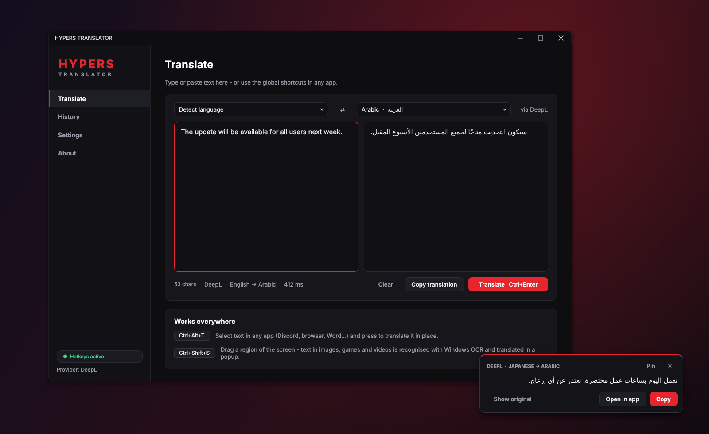
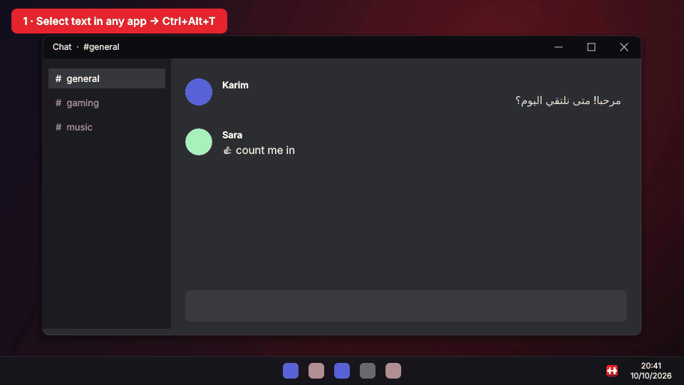
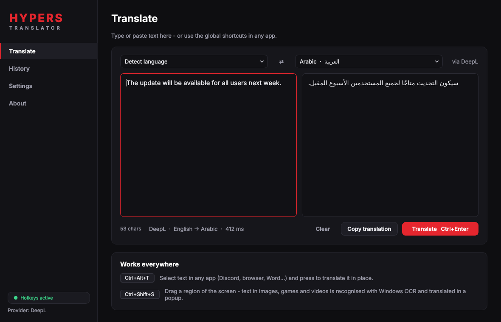
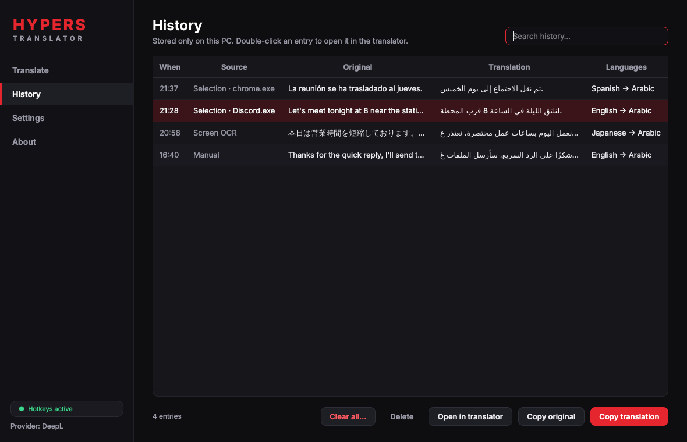
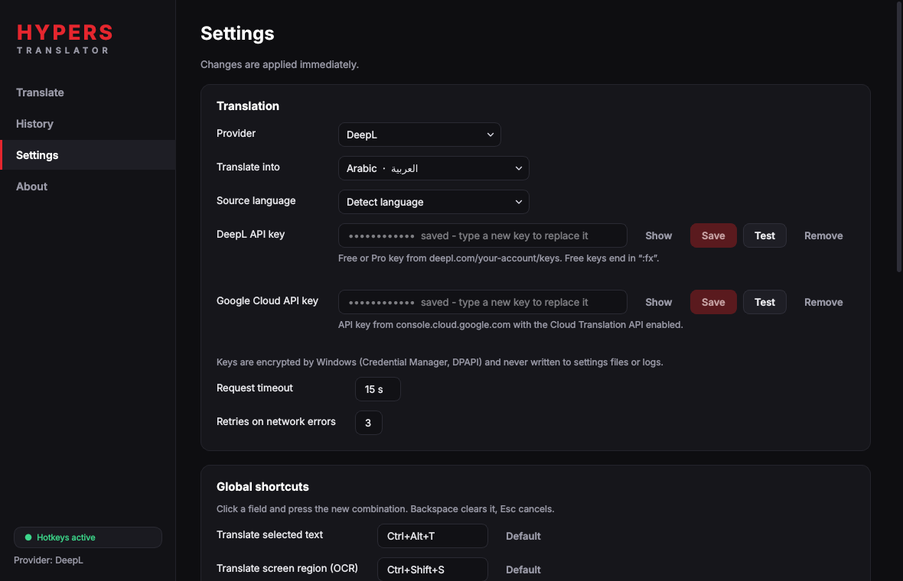
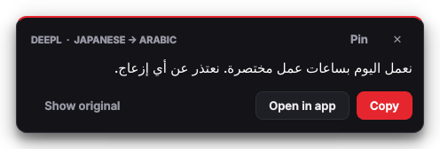

<p align="center">
  
</p>

<h1 align="center">HYPERS TRANSLATOR</h1>

<p align="center">
  <b>System-wide translation for Windows 10 and 11.</b> Translate the text you select in any app, or any text on your screen.<br>
  Written in C++20 with Qt 6 and the Win32 / WinRT APIs.
</p>

<p align="center">
  <a href="../../releases/latest"><b>⬇ Download the latest release</b></a>
</p>

## How it works

<p align="center">
  
</p>

| Shortcut (default) | What it does |
|---|---|
| **Ctrl+Alt+T** | Translates the text selected in **any** app (Discord, browser, Word, VS Code…) and replaces it in place. You can also have it show a popup or copy to the clipboard. |
| **Ctrl+Shift+S** | You drag a screen region. Windows' built-in OCR reads it locally, it is translated, and the result appears in a floating popup next to the region. |

The app starts with Windows and waits quietly in the tray. No window opens until you click it.

## Screenshots

| Translate | History |
|---|---|
|  |  |
| **Settings** | **Result popup** |
|  |  |

## Features

* **Pluggable translation layer.** DeepL API (Free and Pro) and Google Cloud Translation (v2). Requests are async, batched and chunked, with timeouts, exponential-backoff retries that honour `Retry-After`, typed errors and an in-memory cache.
* **Secure API key storage.** Keys go in the Windows Credential Manager (DPAPI-encrypted per user). They are never written to the registry, files or logs.
* **Modern dark UI with red accents.** It has Translate, History, Settings and About pages. On Windows 11 the title bar is dark and the corners are rounded.
* **Tray icon.** Open, capture region, history, settings, pause hotkeys, quit.
* **Settings.**
  * Hotkey recorder (layout-independent).
  * Target and source language, provider choice.
  * Selected-text action (replace, popup or copy).
  * Popup timeout and clipboard timings.
  * OCR language and line merging.
  * Network timeout and retries.
  * Autostart.
  * History on/off and limit.
* **Translation history.** Stored locally in SQLite, searchable, with copy, re-open, delete and clear.
* **Clipboard safety.** Your clipboard (every format: text, images, files…) is snapshotted before the copy and restored after the paste. The temporary translation is excluded from Win+V history, cloud clipboard and clipboard managers.

---

## Download

Prebuilt portable builds are on the [Releases page](../../releases). To install one:

1. Download `HypersTranslator-vX.Y.Z-win64.zip`.
2. Unzip it anywhere and run `HypersTranslator.exe`. No installer or admin rights are needed.

A `.sha256` checksum is published next to each zip.

Maintainers have two ways to publish a release:
- **From GitHub:** go to Actions → *Windows build* → *Run workflow*, and enter a version such as `v1.0.1`.
- **From git:** push a version tag.

Either way, CI builds, tests and packages the app, then attaches the zip to a new GitHub Release:

```bash
git tag v1.0.1 && git push origin v1.0.1
```

---

## Architecture

```
src/
├── main.cpp                     entry: QApplication, logging, single instance, theme
├── app/
│   ├── HypersApp.*              composition root: builds services, wires features/UI/tray
│   └── AppContext.h             service bundle handed to the UI
├── core/                        platform-neutral building blocks
│   ├── AppSettings.*            typed QSettings facade (HKCU\Software\Hypers\HYPERS TRANSLATOR)
│   ├── HistoryStore.*           SQLite history (WAL, pruning, LIKE search)
│   ├── Languages.*              language table + per-provider code mapping
│   ├── Logger.*                 rotating file log (no content, no keys)
│   ├── SingleInstance.*         named mutex + local socket "activate" handoff
│   └── AsyncWait.*              non-blocking poll helper for the GUI thread
├── translation/                 provider-agnostic translation layer
│   ├── ITranslationProvider.h   pure request/response adapter interface
│   ├── DeepLProvider.*          DeepL v2 (free/pro endpoint by key)
│   ├── GoogleTranslateProvider.* Google Cloud Translation v2 (key in header)
│   ├── TranslationService.*     QNetworkAccessManager, batching, retries, timeouts, cache,
│   │                            TranslationReply (QNetworkReply-style async handle)
│   ├── RetryPolicy.*            backoff + jitter + Retry-After parsing
│   ├── TextSegmenter.*          boundary-aware chunking, whitespace preservation
│   └── TranslationTypes.*       request/result/error types, error classification
├── platform/
│   ├── ISecretStore.h           secret storage interface
│   └── win/                     everything Windows-specific
│       ├── GlobalHotkeyManager.* RegisterHotKey + message-only window
│       ├── KeyMapping.*         QKeySequence -> MOD_* / VK_*
│       ├── Clipboard.*          raw Win32 clipboard snapshot/restore/transient text
│       ├── InputSimulator.*     SendInput Ctrl+C / Ctrl+V, modifier state
│       ├── WindowUtils.*        foreground/caret/integrity level, DWM dark frame
│       ├── WinCredentialStore.* Credential Manager (CredWrite/CredRead)
│       ├── WindowsOcrEngine.*   Windows.Media.Ocr via C++/WinRT
│       ├── AutoStart.*          HKCU Run key + Task Manager StartupApproved
│       └── MessageWindow.*      RAII HWND_MESSAGE window
├── features/
│   ├── SelectionTranslator.*    copy -> translate -> replace/popup/copy workflow
│   ├── OcrTranslator.*          region -> OCR (worker thread) -> translate -> popup
│   └── FeatureCommon.h          shared captions + history recording
└── ui/
    ├── MainWindow.*             sidebar shell, About page, close-to-tray
    ├── TranslatePage.*          manual translation
    ├── HistoryPage.*            history table + model
    ├── SettingsPage.*           all settings, key save/test/remove
    ├── ResultPopup.*            frameless, non-activating result card
    ├── RegionSelector.*         per-monitor frozen-screen selection overlays
    ├── HotkeyEdit.*             single-combination shortcut recorder
    ├── LanguageComboBox.*, TrayController.*, Theme.*, UiHelpers.h
resources/  icons (generated by tools/generate_icons.py), dark.qss, manifest, version resource
tests/      Qt Test suites (providers, retry policy, segmenter, key mapping, languages,
            TranslationService against a local mock HTTP server)
```

**Design notes**

* **Providers are pure adapters.** `ITranslationProvider` only builds a `QNetworkRequest` and payload, and parses status and body into a `ProviderResponse`. Timeouts, retries, batching, caching and cancellation live once in `TranslationService`. To add a provider (Azure, LibreTranslate, an LLM…), implement one class, then call `registerProvider()` and add a settings row.
* **Async everywhere.** Network work goes through `QNetworkAccessManager`. OCR runs on a `QtConcurrent` worker in a WinRT MTA. Waiting for key release and clipboard changes uses `QTimer` polling, never `Sleep` on the GUI thread.
* **Safety in the replace flow.**
  * The app checks that the foreground window is still the original one before pasting. If you switched windows, the translation is shown in a popup instead of being typed into the wrong window.
  * It waits until the hotkey's keys are released, so the target app sees Ctrl+C rather than Ctrl+Alt+C.
  * The clipboard is restored only if nobody wrote to it after the paste.
* **Layering.** `core/` and `translation/` have no Windows dependency and are unit-tested on any OS. `platform/win/` isolates every Win32 and WinRT call.

---

## Building

### Prerequisites

* Windows 10 21H2+ or Windows 11, x64
* **Visual Studio 2022 or newer**, with the *Desktop development with C++* workload and a **Windows 11 SDK** (10.0.22000+). The SDK ships the C++/WinRT headers used for OCR.
* **Qt 6.5 or newer** (6.8 LTS recommended), `msvc2022_64` kit. You need the base modules only: Core, Gui, Widgets, Network, Sql, Concurrent, Test.
* **CMake 3.22 or newer**

### Command line

```powershell
# from "x64 Native Tools Command Prompt for VS 2022" or any PowerShell
$env:QTDIR = "C:\Qt\6.8.3\msvc2022_64"

cmake --preset msvc-x64
cmake --build --preset msvc-x64-release
ctest --preset msvc-x64-release

# Self-contained folder with Qt DLLs/plugins (runs windeployqt):
cmake --install build/msvc-x64 --config Release --prefix "$PWD\dist"
# Optional zip:
cd build/msvc-x64; cpack -C Release
```

The executable is `dist\HypersTranslator.exe`. The `dist` folder is portable.

### Visual Studio / Qt Creator

Open the folder (VS) or `CMakeLists.txt` (Qt Creator), pick the Qt 6 MSVC kit, and build the `HypersTranslator` target.

### CI

`.github/workflows/windows-build.yml` does the following on `windows-latest`:

1. Configures, builds and runs the unit tests.
2. Runs `windeployqt`.
3. Uploads the portable build as an artifact.

### Regenerating icons

```powershell
pip install pillow
python tools/generate_icons.py
```

---

## Usage

1. On first start, Settings opens. Paste a DeepL key or a Google Cloud API key, click **Save**, and the key is tested automatically.
   * DeepL: <https://www.deepl.com/your-account/keys>. Free keys end in `:fx`.
   * Google: create an API key in Google Cloud Console and enable the *Cloud Translation API*.
2. Choose the target language. The language you translate *into* applies to all workflows.
3. Select text anywhere and press **Ctrl+Alt+T**.
4. Press **Ctrl+Shift+S** and drag over any text on screen.

**Startup.** On first launch HYPERS TRANSLATOR registers itself to start with Windows. At sign-in it runs quietly in the tray, and no window opens until you click the tray icon or launch the app again. Your shortcuts work right away. You can turn this off in Settings → System & privacy → *Start with Windows*.

Extract the zip to a permanent folder before the first run. If you run the app from inside the zip, Windows runs it from a temporary folder, and autostart is not registered.

Files:

| What | Where |
|---|---|
| Settings | `HKCU\Software\Hypers\HYPERS TRANSLATOR` |
| API keys | Credential Manager → Windows Credentials → `HYPERS_TRANSLATOR/<provider>/api_key` |
| History | `%LOCALAPPDATA%\Hypers\HYPERS TRANSLATOR\history.sqlite` |
| Log | `%LOCALAPPDATA%\Hypers\HYPERS TRANSLATOR\logs\hypers.log` |

---

## Translation quality and service errors

HYPERS TRANSLATOR sends your text to the provider you selected (DeepL or Google Cloud Translation) and shows exactly what that service returns:

* **Wording and accuracy** come from the provider's translation engine. If a translation is wrong or awkward, that is the API's output. Switching provider in Settings often gives a different result.
* **Service errors** come from the provider's API: a rejected or expired API key, a used-up monthly quota, rate limiting, an unsupported language or a temporary outage. The app names the provider in these messages (for example *"DeepL: …"*). You fix them in your DeepL / Google Cloud account, not in the app.
* **Network errors** mean the app could not reach the service at all. Check your internet connection, VPN or proxy.

---

## Windows-specific limits

These limits come from Windows itself, not from the app:

* **Elevated apps (UIPI).** Windows silently drops keystrokes that a normal-integrity process sends to an app running as administrator. HYPERS TRANSLATOR detects this and tells you. To translate inside elevated apps, run it as administrator too. Screen OCR still works on them.
* **Secure desktop.** Hotkeys and input injection don't work on UAC prompts, the lock screen or Ctrl+Alt+Del. This is by design.
* **Hotkeys are first come, first served.** `RegisterHotKey` fails if Windows or another app already owns the combination. The app reports this, and you choose another combination in Settings. Ctrl+Shift+S overrides "Save As" in apps while it is registered. Also, on layouts with AltGr, Ctrl+Alt+*key* is AltGr+*key*. Pick a different shortcut if that collides with a character you type.
* **Clipboard-based selection.** Windows has no universal "get selected text" API, so the selection is read with a simulated Ctrl+C.
  * Apps that don't copy on Ctrl+C can't be handled this way. Use OCR instead.
  * In terminals, Ctrl+C with no selection sends an interrupt.
  * The *source* app's own copy can still appear in Win+V history, because Windows records it before the app gets control back.
* **Windows OCR.**
  * It uses the OCR language packs installed on your PC.
  * It recognises one language/script per capture.
  * To add a language pack, go to Settings → Time & language → Language & region, or run `Add-WindowsCapability -Online -Name "Language.OCR~~~<tag>~0.0.1.0"` (admin).
* **Screen capture.** Windows returns black pixels for windows that opt out of capture (`SetWindowDisplayAffinity`), for example DRM video and some password managers. GDI capture can also miss exclusive-fullscreen games.

---

## Roadmap

1. **UI Automation text pattern** for reading and replacing selections without the clipboard where apps support it. Keep the clipboard as a fallback.
2. **Windows.Graphics.Capture** for HDR and exclusive-fullscreen capture, plus a magnifier loupe and cross-monitor selection.
3. **More providers.** Azure Translator, LibreTranslate (self-hosted) and an LLM provider with tone/formality presets. Also per-app target language rules (for example, Discord → English).
4. **Glossaries and formality.** DeepL glossaries and the `formality` parameter, exposed in Settings.
5. **Installer and updates.** An MSIX package (signed), a winget manifest and an auto-update channel.
6. **Localization of the UI** (Arabic RTL first) and accessibility review (screen readers, high-contrast theme).
7. **OCR improvements.** Automatic script detection that picks the OCR language, and an overlay mode that draws translations over the captured region.
